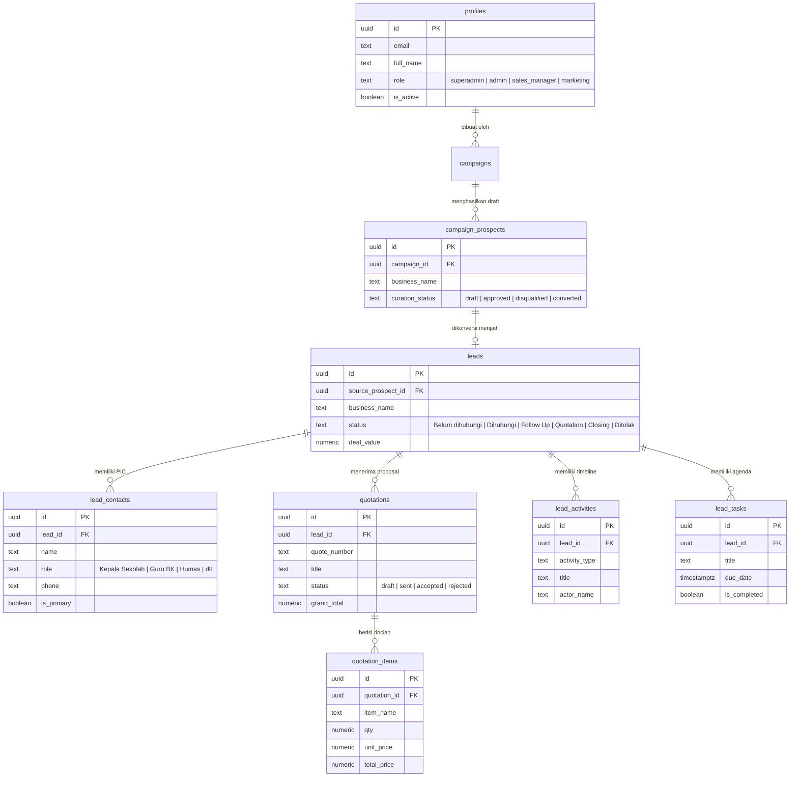

# Worrie.id CRM — Dokumentasi Sistem & Manual Pengguna

> **Working Remotely Indonesia (Worrie.id)**  
> *Pilar Utama: EDUCATION • DIGITAL SKILLS • CAREER READINESS*  
> Platform CRM & Otomasi Prospek B2B untuk Kemitraan Sekolah (SMK/SMA), Perguruan Tinggi, dan Industri Talenta Digital.

---

## 📋 Daftar Isi

1. [Identitas Brand & Desain](#1-identitas-brand--desain)
2. [Arsitektur & Daftar Modul](#2-arsitektur--daftar-modul)
   - [2.1 Modul Dashboard Eksekutif (`/`)](#21-modul-dashboard-eksekutif-)
   - [2.2 Modul Kampanye & Scraper Google Maps (`/projects`)](#22-modul-kampanye--scraper-google-maps-projects)
   - [2.3 Modul Pipeline CRM Kanban (`/crm`)](#23-modul-pipeline-crm-kanban-crm)
   - [2.4 Modul Detail Lead 360° View (`/crm/[id]`)](#24-modul-detail-lead-360-view-crmid)
   - [2.5 Modul Penawaran & Proposal Hub (`/quotations`)](#25-modul-penawaran--proposal-hub-quotations)
   - [2.6 Modul Agenda & Follow-Up Reminders (`/tasks`)](#26-modul-agenda--follow-up-reminders-tasks)
   - [2.7 Modul Template Pesan & AI Generator (`/templates`)](#27-modul-template-pesan--ai-generator-templates)
   - [2.8 Modul Manajemen Tim & RBAC (`/team`)](#28-modul-manajemen-tim--rbac-team)
   - [2.9 Modul Pengaturan Gateway & Database (`/settings`)](#29-modul-pengaturan-gateway--database-settings)
   - [2.10 Modul Autentikasi Google SSO (`/login`)](#210-modul-autentikasi-google-sso-login)
3. [Keamanan Server & Role-Based Access Control (RBAC)](#3-keamanan-server--role-based-access-control-rbac)
   - [Proteksi URL Injection via Edge Middleware](#proteksi-url-injection-via-edge-middleware)
   - [PostgreSQL Anti-Delete Protection (Superadmin)](#postgresql-anti-delete-protection-superadmin)
   - [Injeksi Master Admin Tanpa Hardcode](#injeksi-master-admin-tanpa-hardcode)
4. [Skema Database & Relasi Tabel (PostgreSQL)](#4-skema-database--relasi-tabel-postgresql)
5. [Panduan Instalasi & Menjalankan Aplikasi](#5-panduan-instalasi--menjalankan-aplikasi)
6. [Daftar File Migrasi Database](#6-daftar-file-migrasi-database)

---

## 1. Identitas Brand & Desain

Sistem antarmuka CRM Worrie.id dirancang secara terstandarisasi dengan pedoman:
- **Tema Wajib**: **Light Theme** (Clean, modern SaaS dashboard).
- **Palet Warna Resmi**:
  - **Primary Navy Blue**: `#004a87` (Warna utama navbar, tombol primer, header dokumen).
  - **Aksen Kuning/Gold**: `#f59e0b` / `#d97706` (Aksen edukasi, badge prestisius, pilar kesiapan karir).
  - **Status Semantik**:
    - Emerald Green (`#059669`): Deal Closing, Disetujui, Tugas Selesai.
    - Amber/Orange (`#d97706`): Quotation, Overdue Agenda, Follow-Up Aktif.
    - Rose/Red (`#e11d48`): Ditolak, Terlewat, Peringatan Keamanan.
- **Logo Resmi**: [public/logo.png](file:///Users/diyanto/crm_worrie/public/logo.png) (Worrie.id Education & Digital Readiness).

---

## 2. Arsitektur & Daftar Modul

### 2.1 Modul Dashboard Eksekutif (`/`)
- **Tujuan**: Memberikan visibilitas 360° kepada pimpinan dan tim kemitraan mengenai laju konversi prospek dan efektivitas tim sales.
- **Fitur Utama**:
  - **Ringkasan KPI Matrix**: Total Prospek Terdaftar, Prospek Hot Prioritas (Skor $\ge 80$), Nilai Omset Closing (Rp), dan Total Nilai Proposal Disetujui.
  - **Funnel Distribusi Tahapan CRM**: Progres konversi visual dari tahap *Belum dihubungi* hingga *Closing MoU*.
  - **Peluang Kemitraan**: Analisis instansi tanpa website resmi untuk paket integrasi digital.
  - **Widget Riwayat Aktivitas 360° Real-time**: Audit trail log interaksi terbaru lintas prospek.
  - **Widget Agenda Follow-Up Terdekat**: Daftar tugas follow-up hari ini & status overdue dengan quick action WhatsApp.
  - **Tabel Prospek Hot Leads**: Lembaga berperingkat kesiapan tertinggi siap closing.

### 2.2 Modul Kampanye & Scraper Google Maps (`/projects` & `/projects/[id]`)
- **Tujuan**: Mesin otomasi ekstraksi data prospek instansi sekolah (SMK/SMA), universitas, dan korporat dari Google Maps API.
- **Alur Kerja 2-Lapisan (Two-Layer Workflow)**:
  1. **Hasil Ekstraksi Masuk ke Draft Prospek (`campaign_prospects`)**: Tidak langsung mencemari database leads utama.
  2. **Skrining & Kurasi Prospek**: Tim marketer menyeleksi kelayakan data (nama instansi, ulasan, nomor telepon, status web).
  3. **Konversi ke Leads Resmi ("Convert to Leads")**: Fitur seleksi massal atau satuan untuk memvalidasi prospek menjadi `leads` resmi di database.
  4. **Ekspor Data**: Mendukung ekspor instan daftar prospek ke format Microsoft Excel (.xlsx).

### 2.2B Modul Database Leads (`/leads`)
- **Tujuan**: Direktori dan basis data terpusat seluruh prospek dan calon mitra sekolah/kampus dalam bentuk tabel enterprise lengkap.
- **Fitur Utama**:
  - **Tabel Enterprise**: Menampilkan nama instansi, rating Google Maps, nomor kontak WhatsApp, status pipeline, PIC marketing, estimasi nilai deal, dan tanggal follow-up berikutnya.
  - **Pencarian Cerdas & Multi-Filter**: Menyaring berdasarkan tahapan pipeline (`Belum dihubungi` s.d `Closing/Ditolak`), filter PIC marketing, dan pencarian teks bebas.
  - **Modal Tambah Lead Baru**: Memungkinkan tim marketing mendaftarkan mitra baru secara manual (misal dari panggilan telepon langsung, referral alumni, atau pertemuan tatap muka).
  - **Ekspor Excel Otomatis**: Mengekspor seluruh database leads terfilter ke file spreadsheet `.xlsx`.
  - **Navigasi Cepat 360° View**: Mengklik baris mana saja langsung membuka halaman detail 360° lead (`/crm/[id]`).

### 2.3 Modul Pipeline CRM Kanban (`/crm`)
- **Tujuan**: Manajemen pipeline visual interaktif berbasis kolom Kanban.
- **6 Tahapan Siklus Penjualan**:
  1. `Belum dihubungi`: Prospek baru dari ekstraksi kurasi.
  2. `Dihubungi`: Pesan perkenalan awal telah terkirim via WhatsApp.
  3. `Follow Up`: Sesi diskusi kebutuhan program kemitraan berlangsung.
  4. `Quotation`: Proposal resmi dan surat penawaran harga telah dikirimkan.
  5. `Closing`: Kesepakatan tercapai, penandatanganan MoU program.
  6. `Ditolak`: Belum berminat atau tidak ada anggaran saat ini.
- **Indikator Kartu**: Menampilkan skor potensi, nominal nilai deal (Rp), nomor kontak, dan tombol cepat chat WhatsApp.

### 2.4 Modul Detail Lead 360° View (`/crm/[id]`)
- **Tujuan**: Pusat kendali menyeluruh untuk satu institusi/sekolah mitra.
- **Fitur Lengkap**:
  - **Header Informasi Instansi**: Alamat Google Maps, status website, skor kesiapan, dan pembaruan tahapan deal seketika.
  - **Multi-Kontak PIC (Kontak A, B, C)**: Mengelola banyak narahubung dalam satu institusi (misal: Kepala Sekolah, Guru BK, Kepala Humas/Hubin, Dosen Pembina) dengan penanda kontak utama (*Primary Contact*).
  - **Generator Dokumen Penawaran (Quotation)**:
    - Pembuatan nomor penawaran otomatis (`WORRIE-Q-YYYYMM-XXX`).
    - Input rincian item layanan (Workshop, Bootcamp, Sertifikasi) beserta Qty, Harga Satuan, Diskon, dan PPN.
    - Kalkulasi Subtotal & Grand Total otomatis.
  - **Log Aktivitas 360° (Timeline)**: Riwayat lengkap setiap interaksi dengan form log cepat (*Quick Log*) untuk telepon, chat WA, meeting langsung, dan catatan internal.
  - **Agenda Follow-Up Terintegrasi**: Pembuatan pengingat tugas follow-up dengan notifikasi tenggat waktu.

### 2.5 Modul Penawaran & Proposal Hub (`/quotations`)
- **Tujuan**: Pusat pengelolaan seluruh proposal penawaran harga kemitraan Worrie.id.
- **Fitur Utama**:
  - **Metrik Global**: Total Proposal Dibuat, Nilai Deal Disetujui (Rp), Nilai Proposal Mengambang/Pending (Rp), dan Rasio Kemenangan (*Win Rate* %).
  - **Filter Status Cepat**: `Draft`, `Terkirim`, `Disetujui (Deal)`, `Ditolak`.
  - **Modal Pratinjau & Cetak PDF Resmi**:
    - Desain dokumen berkop surat Worrie.id resmi (*EDUCATION • DIGITAL SKILLS • CAREER READINESS*).
    - Tabel rincian paket program, syarat & ketentuan kerjasama, dan kolom tanda tangan kedua belah pihak.
    - Cetak langsung via browser (`window.print()`) ke printer atau Simpan sebagai PDF.
    - Tombol otomatis kirim ringkasan penawaran langsung ke nomor WhatsApp narahubung.

### 2.6 Modul Agenda & Follow-Up Reminders (`/tasks`)
- **Tujuan**: Memastikan tim pemasaran dan kemitraan tidak pernah melewatkan panggilan tindak lanjut, pengiriman MoU, atau jadwal demo program.
- **Fitur Utama**:
  - **3 Mode Tampilan Switchable**:
    - **Mode List (Daftar)**: Kartu baris agenda dengan indikator waktu, status badges, shortcut WhatsApp, dan klik langsung ke detail lead.
    - **Mode Timeline (Kronologis)**: Alur vertikal berdasarkan tanggal dan jam (WIB), konektor visual berwarna sesuai urgensi status, dan kartu interaktif instansi.
    - **Mode Kalender (Bulanan)**: Grid kalender 7 hari (Senin-Minggu) interaktif dengan navigasi bulan, penanda tanggal hari ini, pill badge agenda di tiap sel tanggal, serta **Modal Popup Multi-List Agenda Harian** dengan kartu animasi interaktif (*staggered entrance, hover elevation, scroll-locking latar belakang, light dismiss via ESC/backdrop, dan tombol langsung ke 360° lead*).
  - **Navigasi Langsung 360° Lead**: Mengklik agenda dari mode mana pun (List/Timeline/Kalender) langsung mengarahkan pengguna ke halaman rincian lead (`/crm/[id]`).
  - **Tab Klasifikasi Waktu**: `Semua Agenda`, `Hari Ini`, `Terlewat (Overdue)`, `Mendatang`, dan `Selesai`.
  - **Penyelesaian 1-Klik**: Centang kotak selesai untuk menyelesaikan tugas; sistem otomatis mencatat aktivitas penyelesaian tugas ke timeline 360° lead terkait.
  - **Tautan Cepat WhatsApp**: Tombol satu klik untuk langsung membuka chat WhatsApp dengan teks template konfirmasi tindak lanjut.
  - **Modal Pembuatan Tugas**: Memilih instansi, mengisi judul aktivitas follow-up, dan menentukan jadwal tenggat waktu.

### 2.7 Modul Template Pesan & AI Generator (`/templates`)
- **Tujuan**: Standardisasi komunikasi WhatsApp tim marketing agar tingkat respon (*open rate*) maksimal.
- **Fitur Utama**:
  - **Generator Pesan Bertenaga AI**: Menghasilkan draf pesan penawaran berdasarkan kategori program, industri, dan gaya bahasa (*friendly*, profesional, promo terbatas).
  - **Placeholder Variabel Cerdas**: Menyisipkan variabel dinamis `{business_name}`, `{rating}`, `{reviews_count}`, dan `{address}` secara otomatis.
  - **Pustaka Template Rekomendasi**: Kumpulan draf pesan yang telah teruji untuk penawaran perdana, follow-up proposal, dan promo bootcamp.

### 2.8 Modul Manajemen Tim & RBAC (`/team`)
- **Tujuan**: Pengelolaan staf internal dan pengaturan hak akses peran kerja (*Role-Based Access Control*).
- **Hirarki Peran**:
  - `superadmin`: Pemilik sistem tertinggi. Dilindungi oleh proteksi database anti-delete.
  - `admin`: Administrator operasional dengan akses konfigurasi gateway dan pengelolaan tim.
  - `sales_manager`: Manajer penjualan yang memantau performa pipeline dan penugasan lead.
  - `marketing`: Staf pelaksana penjangkauan, dilarang mengakses halaman konfigurasi sensitif.
- **Akses Khusus Admin**: Rute ini dilindungi server-side middleware dan hanya dapat dibuka oleh `superadmin` dan `admin`.

### 2.9 Modul Pengaturan Gateway & Database (`/settings`)
- **Tujuan**: Konfigurasi teknis integrasi sistem.
- **Fitur Utama**:
  - **WhatsApp API Gateway**: Pengaturan penyedia gateway (Xsender, Fonnte, Waha) beserta token autentikasi, URL endpoint, dan batas pengiriman pesan (*rate limit*).
  - **Profil Agensi**: Pengaturan identitas perusahaan yang dicantumkan pada kop surat penawaran.
  - **Status Konektivitas Supabase**: Monitoring status koneksi basis data cloud PostgreSQL.

### 2.10 Modul Autentikasi Google SSO (`/login`)
- **Tujuan**: Pintu masuk resmi pengguna dengan Single Sign-On Google Workspace.
- **Fitur Utama**:
  - Desain Light Theme modern dengan kartu login elegan senada identitas Worrie.id.
  - Integrasi Supabase OAuth Google Sign-In.
  - Pengalihan otomatis (*callback handler*) yang menyinkronkan profil pengguna ke tabel `profiles`.

---

## 3. Keamanan Server & Role-Based Access Control (RBAC)

### Proteksi URL Injection via Edge Middleware
File [src/middleware.ts](file:///Users/diyanto/crm_worrie/src/middleware.ts) berjalan pada layer server/edge untuk menjamin keamanan:
1. **Sesi Pengguna Wajib**: Pengguna yang belum login otomatis dialihkan (HTTP 307) ke `/login` jika mencoba membuka rute dashboard (`/`, `/crm`, `/quotations`, `/tasks`, `/projects`, `/team`, `/settings`).
2. **Proteksi Khusus Admin**: Rute `/team` dan `/settings` diperiksa secara ketat. Jika pengguna yang sedang login memiliki peran `marketing`, middleware secara otomatis memblokir akses dan mengalihkan pengguna ke:
   ```
   /?error=unauthorized_admin_only
   ```
   Halaman dashboard akan memunculkan banner peringatan bahwa rute tersebut hanya diperuntukkan bagi Administrator.

### PostgreSQL Anti-Delete Protection (Superadmin)
Akun dengan peran `superadmin` dilindungi pada level terdalam basis data (PostgreSQL trigger) melalui migrasi [20261027105500_add_superadmin_role_and_anti_delete_protection.sql](file:///Users/diyanto/crm_worrie/supabase/migrations/20261027105500_add_superadmin_role_and_anti_delete_protection.sql):
- **Larangan Hapus**: Query `DELETE FROM profiles WHERE role = 'superadmin'` akan memicu exception PostgreSQL:
  > *"Akun Superadmin dilindungi sistem dan TIDAK BISA DIHAPUS!"*
- **Larangan Deaktivasi**: Query `UPDATE profiles SET is_active = false WHERE role = 'superadmin'` akan dibatalkan seketika.
- **Larangan Demosi**: Query penurunan peran dari `superadmin` ke peran lain akan ditolak oleh trigger.

### Injeksi Master Admin Tanpa Hardcode
Sesuai prinsip keamanan modern, email Master Admin tidak di-hardcode di dalam kode program:
- Dideklarasikan melalui environment variable:
  ```env
  MASTER_ADMIN_EMAIL=diyanto2911@gmail.com
  NEXT_PUBLIC_MASTER_ADMIN_EMAIL=diyanto2911@gmail.com
  ```
- Trigger database [handle_new_user()](file:///Users/diyanto/crm_worrie/supabase/migrations/20261027100800_auth_google_sso_and_profiles_trigger.sql) secara otomatis menetapkan peran `superadmin` apabila email pengguna baru yang login via Google SSO cocok dengan master admin.

---

## 4. Skema Database & Relasi Tabel (PostgreSQL)



---

## 5. Panduan Instalasi & Menjalankan Aplikasi

### Kebutuhan Perangkat Lunak
- **Node.js**: Versi 18.18+ atau 20+
- **NPM** atau **PNPM**
- **Supabase Project** dengan PostgreSQL

### Konfigurasi Lingkungan (`.env.local`)
Buat file `.env.local` di root proyek:
```env
# Supabase Cloud Configuration
NEXT_PUBLIC_SUPABASE_URL=https://zzghsltzfizhwouhcpkh.supabase.co
NEXT_PUBLIC_SUPABASE_ANON_KEY=eyJhbGciOi...
SUPABASE_SERVICE_ROLE_KEY=eyJhbGciOi...

# Master Admin Email (Anti-Delete Superadmin)
MASTER_ADMIN_EMAIL=diyanto2911@gmail.com
NEXT_PUBLIC_MASTER_ADMIN_EMAIL=diyanto2911@gmail.com
```

### Menjalankan Server Pengembangan
```bash
# 1. Jalankan development server
npm run dev

# 2. Verifikasi tipe data TypeScript
npx tsc --noEmit

# 3. Validasi build produksi Next.js
npm run build
```

Buka peramban di `http://localhost:3000`.

---

## 6. Daftar File Migrasi Database

Seluruh perubahan struktur tabel tercatat secara idempotent di direktori `supabase/migrations/`:

| Tanggal & Waktu | File Migrasi SQL | Deskripsi |
|---|---|---|
| 2026-10-27 09:45 | [20261027094500_crm_upgrade_draft_contacts_activities_quotations.sql](file:///Users/diyanto/crm_worrie/supabase/migrations/20261027094500_crm_upgrade_draft_contacts_activities_quotations.sql) | Pembentukan 9 tabel inti: `profiles`, `campaigns`, `campaign_prospects`, `leads`, `lead_contacts`, `quotations`, `quotation_items`, `lead_activities`, `lead_tasks`, dan `app_settings`. |
| 2026-10-27 10:08 | [20261027100800_auth_google_sso_and_profiles_trigger.sql](file:///Users/diyanto/crm_worrie/supabase/migrations/20261027100800_auth_google_sso_and_profiles_trigger.sql) | Trigger sinkronisasi otomatis Google SSO `handle_new_user()` saat user pertama kali masuk. |
| 2026-10-27 10:50 | [20261027105000_inject_master_admin_account.sql](file:///Users/diyanto/crm_worrie/supabase/migrations/20261027105000_inject_master_admin_account.sql) | Skrip promosi peran master admin `diyanto2911@gmail.com`. |
| 2026-10-27 10:55 | [20261027105500_add_superadmin_role_and_anti_delete_protection.sql](file:///Users/diyanto/crm_worrie/supabase/migrations/20261027105500_add_superadmin_role_and_anti_delete_protection.sql) | Penambahan peran `'superadmin'` dan trigger database proteksi anti-delete & anti-deaktivasi. |

*Catatan riwayat lengkap migrasi dapat dilihat di [MIGRATIONS.md](file:///Users/diyanto/crm_worrie/MIGRATIONS.md).*

---

&copy; 2026 **Worrie.id** — Working Remotely Indonesia. All rights reserved.
